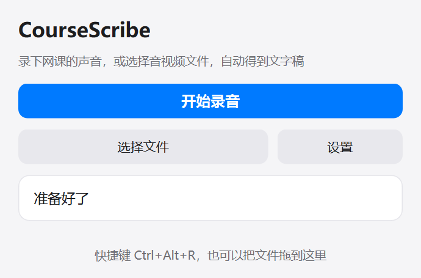
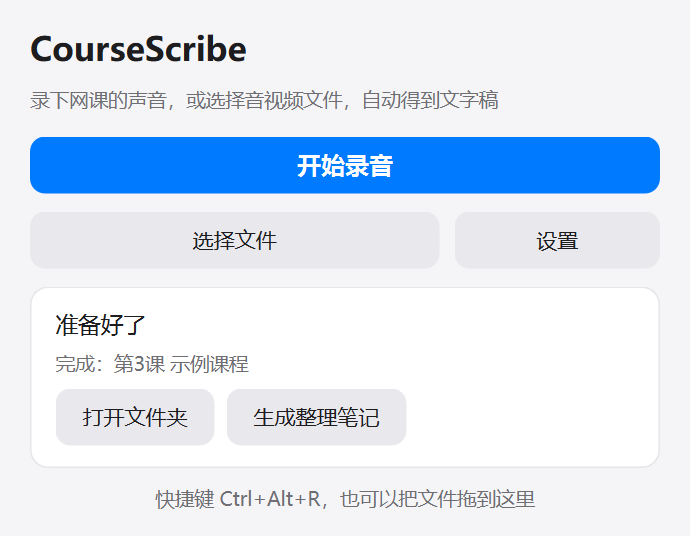
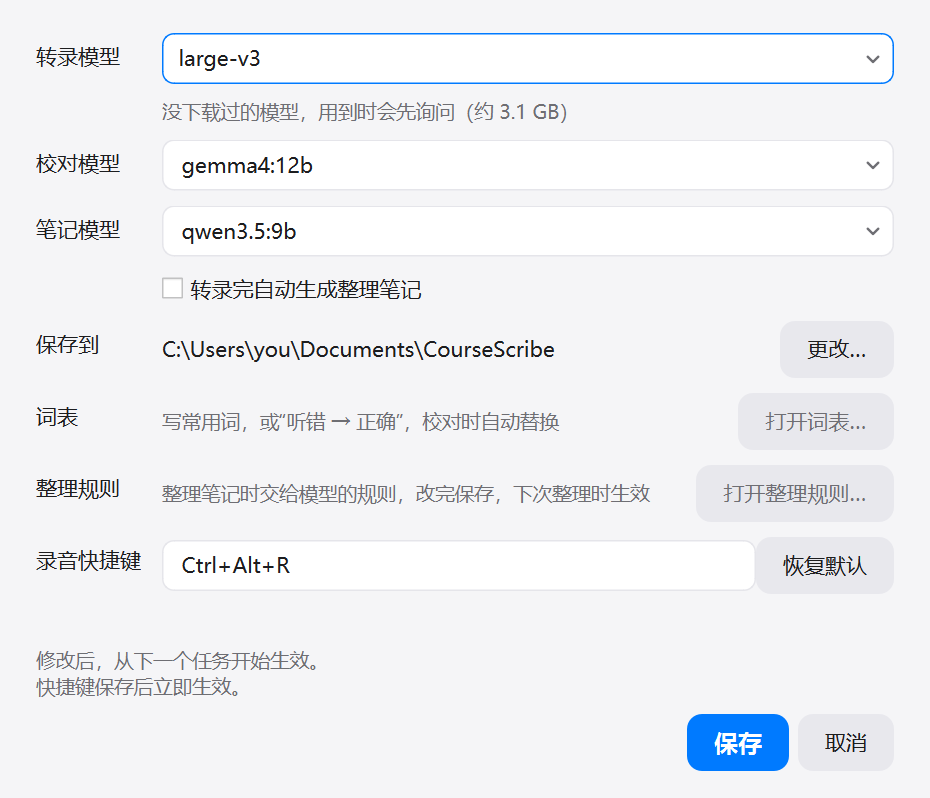

# CourseScribe

[中文说明](README.zh-CN.md)

Record an online course while you watch it, or pick local audio and video files, and get a **full transcript plus a proofread version**. Press one button (or one hotkey), watch the class as usual, and come back to a folder with the recording, a `.txt` and a `.md`. CourseScribe keeps the speaker's wording: it does not summarize. Everything runs on your own computer. Audio and text never leave it, and there are no analytics.

This is the second piece of software I (Jeremy) built by working with an AI coding assistant ([Claude Code](https://claude.com/claude-code)), test-first from the start. The first was [snapocr](https://github.com/Jeremy-creater/snapocr).

> The user interface is in **Chinese only** for now. It is built for Chinese lectures with English terms mixed in; other languages are untested.

## Screenshots

| Main window | After a file is done | Settings |
|---|---|---|
|  |  |  |

## What you get

Every task gets its own folder under your save folder (by default `CourseScribe` in your Documents folder):

```text
CourseScribe/
└── 2026-11-01 19-30 录音/
    ├── 2026-11-01 19-30 录音.wav            the recording (only for recordings, not for files you pick)
    ├── 2026-11-01 19-30 录音.txt            the raw transcript, written first, never edited afterwards
    ├── 2026-11-01 19-30 录音.md             the proofread transcript
    └── 2026-11-01 19-30 录音-整理笔记.md    study notes (optional, see below)
```

- **`.txt`, the raw transcript.** Everything the transcription model heard. Nothing edits it after it is written.
- **`.md`, the proofread transcript.** A local language model fixes typos and homophones and adds punctuation, sentence breaks and paragraphs. It may delete only three things: filler sounds (嗯, 呃, 啊 ...), spoken tics (对吧, 对不对, "this" or "that" used as a pause ...) and an immediate stutter-style repeat. Any other deletion is detected and that paragraph is retried; if it still fails, you get the rule-cleaned text and are told how many paragraphs were not proofread. It never summarizes or rewrites.
- **`-整理笔记.md`, study notes (optional).** A second local model turns the proofread transcript into review notes: core idea, an outline, sections in lecture order, cases, analogies, quotes, prompts and a closing summary. The program, not the model, writes the header and the outline links, checks every quote word for word against the transcript (and deletes the ones that do not match), and keeps only concept tags that appear in the text. The notes are a first draft written by a model, so read them. This file is separate: the `.txt` and the `.md` are never changed.
- Existing files are never overwritten (a number is added instead), and your original audio and video files are only read, never changed.

## Features

- **Record the sound your computer plays**, not the microphone. No virtual sound card and no change to your sound settings. On a Mac you grant a permission once. The recording is written to disk as it goes, so a crash or a forced close loses at most the last few seconds.
- **Pick files or drag them onto the window**, several at once; they are processed in order. Supported: mp3, wav, m4a, flac, aac, ogg, opus, wma, mp4, mkv, mov, avi, webm, flv, ts.
- **A global hotkey** starts and stops recording from any window: `Ctrl+Alt+R` on Windows, `⌃⌥R` on a Mac. You can change it in Settings.
- **A word list** for names and terms the model mishears: one `heard → correct` pair per line, applied before proofreading.
- **Survives trouble.** Closing the program, a crash, sleep, a pulled headphone, a busy file, a full disk, a stopped Ollama: each shows a plain-language reason and a way to continue. Tasks are saved after every step and resume when you reopen the program. If the recording stays silent for a while, it warns you. If the output device changes (you plug in headphones), the recording follows it.
- **Keeps the computer awake** while recording and processing. Closing the laptop lid still puts it to sleep.
- **Nothing is downloaded silently.** The program tells you the size and asks before it downloads a model.

## Download and run (no Python needed)

Download the zip for your system from the [Releases page](https://github.com/Jeremy-creater/CourseScribe/releases/latest). Models are not included (see [Models and Ollama](#models-and-ollama)).

### Windows

1. Unzip `CourseScribe-<version>-windows-x64.zip` anywhere. Keep the `_internal` folder next to `CourseScribe.exe`.
2. Double-click `CourseScribe.exe`.
3. The first time, Windows may show **"Windows protected your PC"**, because the program has no paid code-signing certificate. Click **More info**, then **Run anyway**.

### macOS (Apple silicon)

1. Unzip `CourseScribe-<version>-macos-arm64.zip` and drag `CourseScribe.app` to Applications.
2. If macOS blocks the first start, open System Settings → Privacy & Security, find CourseScribe and click **Open Anyway**. The app has no Apple developer signature.
3. The first recording asks for permission to record system audio. Allow it. A new version may ask again, because each build has a new temporary signature.

To update, quit the program and unzip the new version over the old folder; your settings and tasks are kept.

## Models and Ollama

CourseScribe uses two kinds of models. None of them is part of this repository or the download.

| Job | Model | Where it runs | How you get it |
|---|---|---|---|
| Transcription | Whisper `large-v3` (about 3.1 GB) | inside the program ([faster-whisper](https://github.com/SYSTRAN/faster-whisper)) | downloaded from Hugging Face on the first task, **after you agree** |
| Proofreading | `gemma4:12b` (default) | [Ollama](https://ollama.com), on your computer | `ollama pull gemma4:12b` |
| Study notes (optional) | `qwen3.5:9b` (default) | Ollama | `ollama pull qwen3.5:9b` |

Install and start [Ollama](https://ollama.com) first. If Ollama is not running or a model is missing, the `.txt` is still written, the task shows "waiting for proofreading" with what to do, and one click continues it once the problem is fixed. Models have their own licenses: read the license of a model before you use it. You can choose other models in Settings; any model installed in Ollama appears in the list.

The program talks only to the Ollama on your own computer (`127.0.0.1`) and bypasses any system proxy for it.

## Requirements

- **Windows 11** (64-bit), or **macOS 14.2 or newer on Apple silicon** (recording system audio needs 14.2).
- Disk: about 1.3 GB for the Windows program (it includes the NVIDIA libraries for the GPU), about 240 MB for the Mac app, plus the models: transcription 3.1 GB, and several GB for each Ollama model.
- Memory: transcription peaked at about 4 GB in my tests.
- **Speed.** I measured on my own machines only:
  - Windows, RTX 5080 (16 GB): a one-hour synthetic-speech recording was transcribed in about 3.5 minutes and proofread in about 1.6 minutes. If the GPU cannot be used (for example, its memory is taken by another program), the program falls back to the processor and tells you it will be slower.
  - Mac, M1 Pro (16 GB): transcription runs on the processor at about 0.8x real time, so a one-hour class takes roughly 48 minutes. Proofreading and notes were not timed on the Mac.
  - Notes: one proofread lesson (about 3,000 characters) took 13 seconds with `qwen3.5:9b` on the RTX 5080. A very long text (about 13,000 characters, not proofread) once failed because the model's answer hit its length limit; the program says so and you can retry.
- Windows 10 and Intel Macs are untested.

## Daily use

1. Open CourseScribe. Click **开始录音** (start recording) or press the hotkey.
2. Watch the class as usual; the sound still plays from your speakers.
3. Click stop or press the hotkey again, and leave. The recording is transcribed and proofread by itself.
4. To use files instead, drag them onto the window or click **选择文件** (choose files).
5. For study notes, click **生成整理笔记** (make notes) after a task is done, or drag an existing proofread `.md` onto the window, or tick the option in Settings to make notes automatically.

**Settings** has: the transcription, proofreading and notes models; the save folder; the word list; the notes rules; and the recording hotkey. A hotkey must include Ctrl, Alt or (on a Mac) Command, plus a letter, digit or F1 to F12. If another program already uses it, the old one stays and the program tells you.

**Notes rules.** The instructions given to the notes model are a plain text file you can edit (Settings → 打开整理规则…). A general set ships with the program; your edits apply from the next run, and your file is never overwritten.

## Where things are

| What | Windows | macOS |
|---|---|---|
| Results | `Documents\CourseScribe` (or the folder you chose) | `~/Documents/CourseScribe`; if Documents is synced by iCloud, `~/CourseScribe` |
| Settings, task state, word list, notes rules, logs | `%LOCALAPPDATA%\CourseScribe` | `~/Library/Application Support/CourseScribe` |

If your Documents folder is synced by OneDrive or iCloud, the default save folder becomes `CourseScribe` in your home folder, because audio and transcripts must not be uploaded automatically. A folder you choose yourself is never changed. The log file is `logs/coursescribe.log` in the settings folder.

To uninstall, delete the program folder (or the `.app`), the settings folder above and, if you want, your results.

## Privacy

- Audio and transcripts do not leave your computer. The only network use is downloading the transcription model, after you agree. The program has no analytics and uploads nothing.
- Proofreading and notes go only to your local Ollama.
- Your original files are never changed. The recording is a copy in the task folder.

## Install from source

You need Python 3.12 and Ollama.

```text
python -m pip install -e .[dev,gpu]    # on a Mac use .[dev]; [gpu] adds the NVIDIA libraries on Windows
python -m coursescribe
```

## Build the app

```text
python -m PyInstaller packaging/coursescribe.spec --noconfirm
```

On Windows the result is the folder `dist/CourseScribe` (run `CourseScribe.exe`). On a Mac it is `dist/CourseScribe.app`. Models are not included.

## Development

The requirements are in [docs/PRD.md](docs/PRD.md) (Chinese). The project was developed test-first with Claude Code and the [tdd-guardian](https://github.com/xiaolai/tdd-guardian-for-claude) plugin. Business logic is kept apart from input and output, system-specific code (recording, hotkeys, keep-awake) lives only under `src/coursescribe/platform/`, and the window only shows state and sends actions.

```text
python -m pytest -m "not engine and not integration and not gui and not perf"
```

| Group | What it covers | When to run |
|---|---|---|
| unit | pure logic and fakes; needs no model, network or desktop | always |
| engine | the real transcription model in-process | after changing transcription code |
| integration | a real running Ollama | by hand |
| gui | the real desktop: recording, hotkeys, permissions, drag and drop | by hand |
| perf | timing | by hand |

## License

[MIT](LICENSE). Third-party components and their licenses: [THIRD_PARTY_NOTICES.md](THIRD_PARTY_NOTICES.md).
