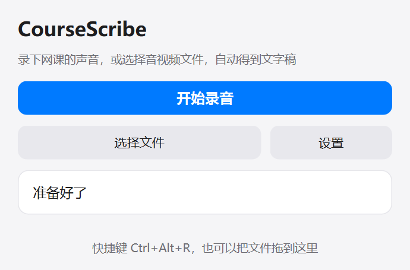
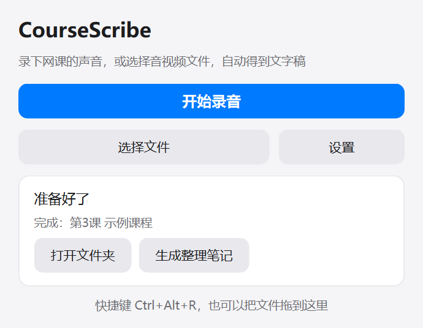
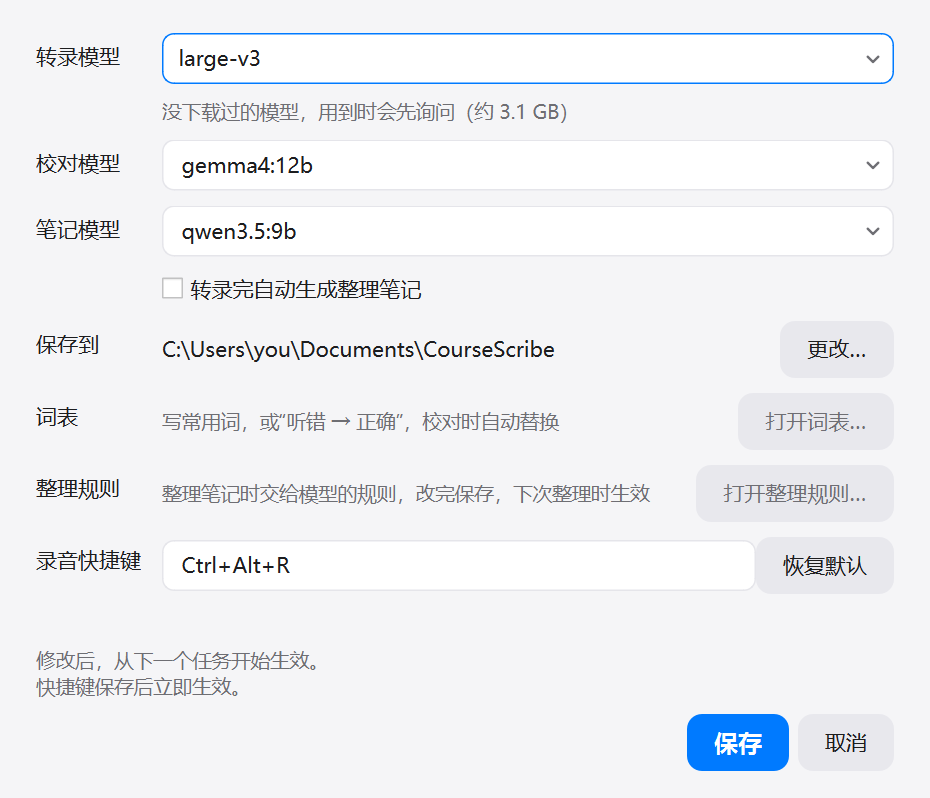

# CourseScribe

[English](README.md)

看网课时一键录下电脑播放的声音，或者选本地音视频文件，自动得到**完整的文字稿和校对后的文字稿**。点一下按钮（或按一个快捷键），照常看课，回来时文件夹里已经有录音、`.txt` 和 `.md`。校对稿保留讲课人的原话，不做总结。一切都在你自己的电脑上运行：音频和文字不会离开电脑，也没有任何使用统计。

这是我（Jeremy）和 AI 编程助手（[Claude Code](https://claude.com/claude-code)）一起、从第一行起先写测试再写代码做出来的第二款软件，第一款是 [snapocr](https://github.com/Jeremy-creater/snapocr)。

> 界面目前只有中文，针对“中文讲课夹英文术语”的网课做的；其他语言没有测过。

## 截图

| 主窗口 | 做完一个文件 | 设置 |
|---|---|---|
|  |  |  |

## 你会得到什么

每个任务在保存文件夹里有自己的子文件夹（默认是“文档”里的 `CourseScribe`）：

```text
CourseScribe/
└── 2026-11-01 19-30 录音/
    ├── 2026-11-01 19-30 录音.wav            录音（只有录音任务有，选文件的任务没有）
    ├── 2026-11-01 19-30 录音.txt            原始文字稿，最先写出来，之后没有任何步骤会改它
    ├── 2026-11-01 19-30 录音.md             校对后的文字稿
    └── 2026-11-01 19-30 录音-整理笔记.md    学习笔记（可选，见下）
```

- **`.txt`，原始文字稿。** 转录模型听到的全部内容。写好以后没有任何步骤会修改它。
- **`.md`，校对稿。** 本地语言模型改错别字和同音字，加标点、断句、分段。它只允许删三类东西：语气词（嗯、呃、啊……）、口头禅（对吧、对不对、作停顿用的“这个”“那个”……）和紧挨着的口吃式重复。除此以外的删减会被检测出来，那一段重试；仍不合格就用只按规则清理过的文字，并告诉你有几段没校对。它不总结、不改写。
- **`-整理笔记.md`，学习笔记（可选）。** 第二个本地模型把校对稿整理成复习用的笔记：核心宗旨、本课脉络、按讲课顺序分节、案例、类比、引述、提示词、结尾总结。开头信息和脉络链接由程序写，不靠模型；每条引述由程序和校对稿逐字核对，对不上的删掉；概念标签只保留原文里出现过的。笔记是模型写的初稿，需要你自己看一遍。这是单独的文件，`.txt` 和 `.md` 不会被改。
- 已有的文件从不覆盖（重名时自动加序号）；你的原始音视频文件只读取，不修改。

## 功能

- **录下电脑播放的声音**，不录麦克风。不需要虚拟声卡，也不用改声音设置；Mac 只需首次授权。录音边录边写入磁盘，程序崩溃或被强制关闭，最多丢失最后几秒。
- **选文件或把文件拖进窗口**，可以一次放多个，按顺序处理。支持 mp3、wav、m4a、flac、aac、ogg、opus、wma、mp4、mkv、mov、avi、webm、flv、ts。
- **全局快捷键**：在任何窗口里都能开始/停止录音，Windows 默认 `Ctrl+Alt+R`，Mac 默认 `⌃⌥R`，可以在设置里改。
- **词表**：写常被听错的人名和术语，每行一条“听错 → 正确”，校对前自动替换。
- **出问题也不慌。** 关掉程序、崩溃、电脑睡眠、拔掉耳机、文件被占用、磁盘满、Ollama 没启动：每种情况都会用大白话说明原因和怎么继续。每完成一步就保存任务，重新打开程序后接着做。录音持续无声时会提醒你；录音中换了输出设备（插上耳机），录音会跟着换。
- **录音和处理期间不让电脑自动睡眠**。合上笔记本盖子仍然会睡眠。
- **不会悄悄下载。** 下载模型前，程序会说明大小并征得你同意。

## 下载并运行（不需要装 Python）

到 [Releases 页面](https://github.com/Jeremy-creater/CourseScribe/releases/latest) 下载对应系统的 zip。模型不在包里（见[模型和 Ollama](#模型和-ollama)）。

### Windows

1. 把 `CourseScribe-<版本>-windows-x64.zip` 解压到任意文件夹。`_internal` 文件夹要和 `CourseScribe.exe` 放在一起。
2. 双击 `CourseScribe.exe`。
3. 第一次运行，Windows 可能提示“Windows 已保护你的电脑”，因为程序没有付费的代码签名证书。点“更多信息”，再点“仍要运行”。

### macOS（Apple 芯片）

1. 解压 `CourseScribe-<版本>-macos-arm64.zip`，把 `CourseScribe.app` 拖进“应用程序”。
2. 第一次打开被拦时，到“系统设置 → 隐私与安全性”，找到 CourseScribe，点“仍要打开”。这个 app 没有苹果开发者签名。
3. 第一次录音时系统会问是否允许录制系统声音，点允许。换新版本后可能要重新授权，因为每次打包的临时签名都不一样。

更新：退出程序，把新版本解压覆盖旧文件夹，设置和任务都会保留。

## 模型和 Ollama

CourseScribe 用两类模型，都不在本仓库和下载包里。

| 用途 | 模型 | 在哪里运行 | 怎么获得 |
|---|---|---|---|
| 转录 | Whisper `large-v3`（约 3.1 GB） | 程序内部（[faster-whisper](https://github.com/SYSTRAN/faster-whisper)） | 第一个任务时从 Hugging Face 下载，**先问你同意** |
| 校对 | `gemma4:12b`（默认） | 你电脑上的 [Ollama](https://ollama.com) | `ollama pull gemma4:12b` |
| 整理笔记（可选） | `qwen3.5:9b`（默认） | Ollama | `ollama pull qwen3.5:9b` |

先安装并启动 [Ollama](https://ollama.com)。Ollama 没启动或缺模型时，`.txt` 照常生成，任务显示“等待校对”并说明怎么处理，问题解决后点一下就继续。模型有各自的许可证，使用前请先读。你可以在设置里换别的模型，Ollama 里装了的模型都会出现在列表里。

程序只连你自己电脑上的 Ollama（`127.0.0.1`），并且不走系统代理。

## 系统要求

- **Windows 11**（64 位），或 **macOS 14.2 及以上、Apple 芯片**（录系统声音需要 14.2）。
- 磁盘：Windows 版约 1.3 GB（含给显卡用的 NVIDIA 库），Mac 版约 240 MB，另加模型：转录 3.1 GB，每个 Ollama 模型几个 GB。
- 内存：我的测试里转录峰值约 4 GB。
- **速度。** 只在我自己的电脑上测过：
  - Windows，RTX 5080（16 GB）：1 小时的合成语音，转录约 3.5 分钟，校对约 1.6 分钟。显卡这次用不了（比如显存被别的程序占满）时，程序改用处理器，并告诉你会慢一些。
  - Mac，M1 Pro（16 GB）：转录在处理器上跑，约 0.8 倍实时，1 小时的课要约 48 分钟。Mac 上的校对和整理笔记没有测过耗时。
  - 整理笔记：一节校对稿（约 3000 字）在 RTX 5080 上用 `qwen3.5:9b` 花了 13 秒。一份很长的文字稿（约 1.3 万字、未校对）有一次因为模型的回答写到长度上限而失败，程序会说明原因，可以重试。
- Windows 10 和 Intel 芯片的 Mac 没有测过。

## 日常使用

1. 打开 CourseScribe，点“开始录音”或按快捷键。
2. 照常看课，声音仍然从扬声器放出来。
3. 看完点“停止”或再按一次快捷键，可以直接离开。录音会自动转录和校对。
4. 已有音视频文件：把文件拖进窗口，或点“选择文件”。
5. 要学习笔记：任务做完后点“生成整理笔记”；或把已有的校对稿 `.md` 拖进窗口；或在设置里勾选“转录完自动生成整理笔记”。

**设置**里可以改：转录、校对和笔记模型，保存文件夹，词表，整理规则，录音快捷键。快捷键必须带 Ctrl、Alt（Mac 上还有 Command）中的至少一个，主键只能是字母、数字或 F1–F12。新组合被别的程序占用时，继续用原来的，并告诉你。

**整理规则。** 交给笔记模型的说明是一个文本文件，可以自己改（设置 → 打开整理规则…）。程序自带一份通用规则；你改完保存，从下一次整理开始生效，你的文件不会被覆盖。

## 文件在哪里

| 内容 | Windows | macOS |
|---|---|---|
| 结果 | `文档\CourseScribe`（或你选的文件夹） | `~/Documents/CourseScribe`；文稿被 iCloud 同步时是 `~/CourseScribe` |
| 设置、任务状态、词表、整理规则、日志 | `%LOCALAPPDATA%\CourseScribe` | `~/Library/Application Support/CourseScribe` |

“文档”文件夹被 OneDrive 或 iCloud 同步时，默认保存位置会改到用户主文件夹下的 `CourseScribe`，因为音频和文稿不能被自动上传。你自己选的文件夹不受影响。日志文件是设置文件夹里的 `logs/coursescribe.log`。

卸载：删掉程序文件夹（Mac 上是 `.app`）和上面的设置文件夹；结果文件夹要不要删由你决定。

## 隐私

- 音频和文字稿不离开你的电脑。程序只在下载转录模型时联网，而且要先征得你同意；没有使用统计，不上传任何内容。
- 校对和整理笔记只连你本机的 Ollama。
- 你的原始文件不会被修改；录音是任务文件夹里的一份副本。

## 从源码安装

需要 Python 3.12 和 Ollama。

```text
python -m pip install -e .[dev,gpu]    # Mac 上用 .[dev]；[gpu] 在 Windows 上装 NVIDIA 库
python -m coursescribe
```

## 自己打包

```text
python -m PyInstaller packaging/coursescribe.spec --noconfirm
```

Windows 上得到文件夹 `dist/CourseScribe`（运行 `CourseScribe.exe`），Mac 上得到 `dist/CourseScribe.app`。模型不包含在里面。

## 开发

需求写在 [docs/PRD.md](docs/PRD.md)。项目用 Claude Code 和 [tdd-guardian](https://github.com/xiaolai/tdd-guardian-for-claude) 插件、先写测试再写代码的方式开发。业务逻辑和输入输出分开；录音、快捷键、防睡眠等系统相关代码只放在 `src/coursescribe/platform/` 下；窗口只显示状态和发出操作。

```text
python -m pytest -m "not engine and not integration and not gui and not perf"
```

| 分组 | 内容 | 什么时候跑 |
|---|---|---|
| unit | 纯逻辑和假实现，不需要模型、网络和桌面 | 每次 |
| engine | 进程内的真实转录模型 | 改转录相关代码时 |
| integration | 真实运行中的 Ollama | 手动 |
| gui | 真实桌面：录音、快捷键、权限、拖放 | 手动 |
| perf | 耗时实测 | 手动 |

## 许可证

[MIT](LICENSE)。第三方组件及其许可证见 [THIRD_PARTY_NOTICES.md](THIRD_PARTY_NOTICES.md)。
